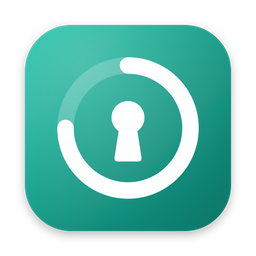
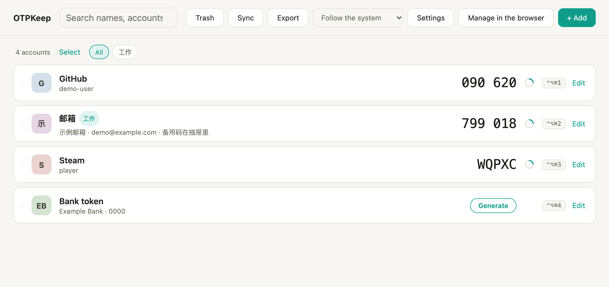
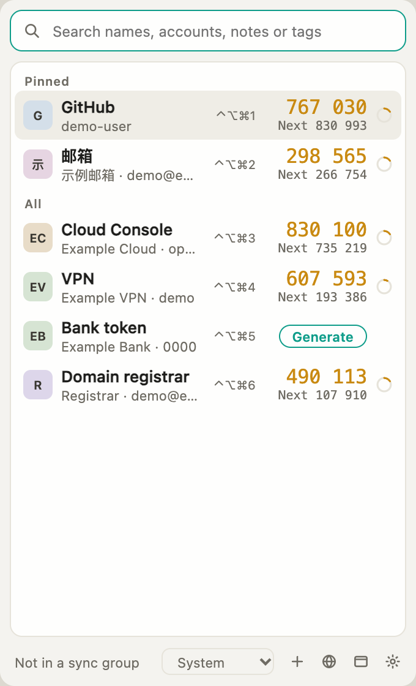
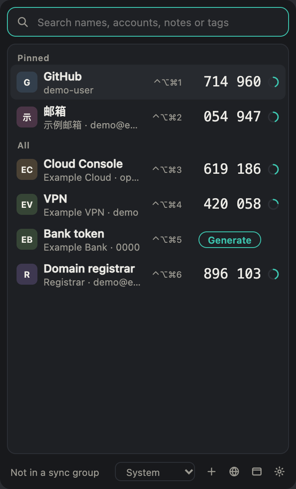
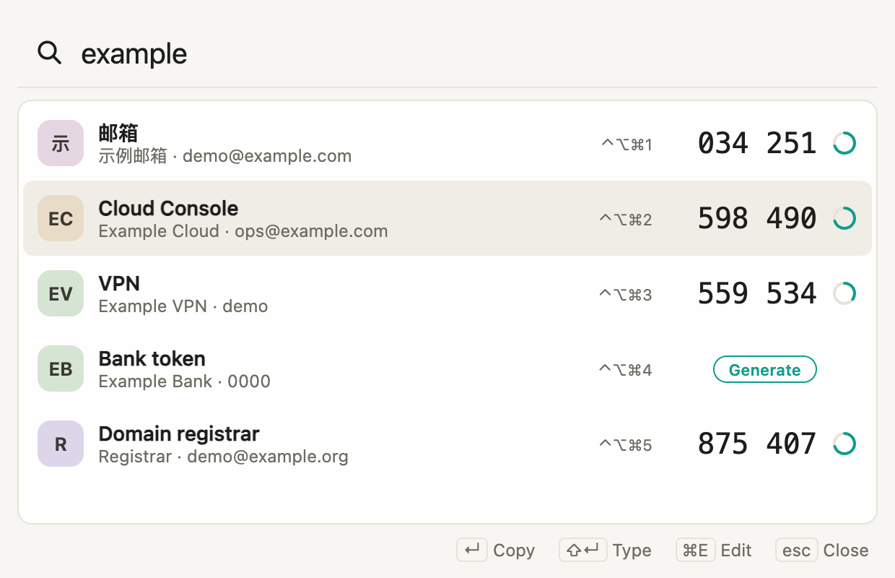
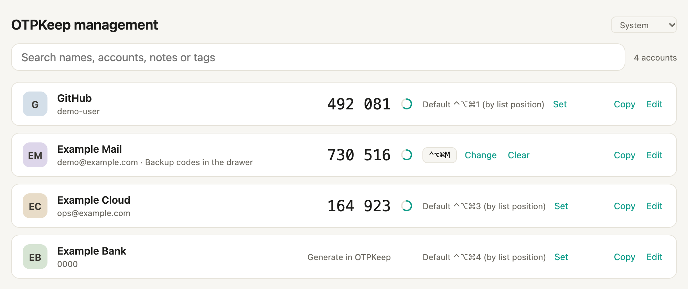
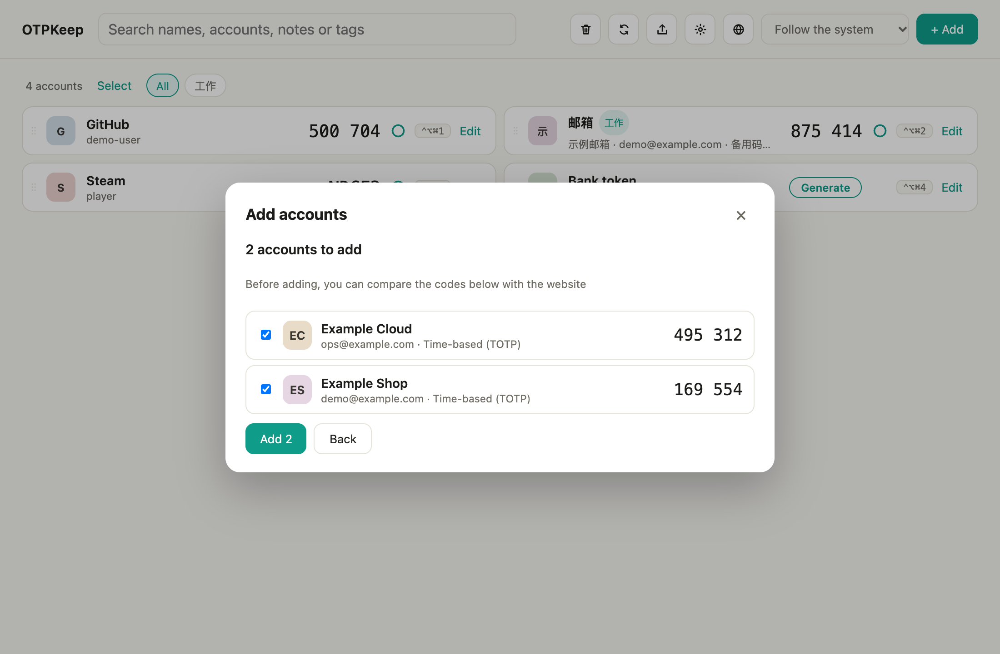
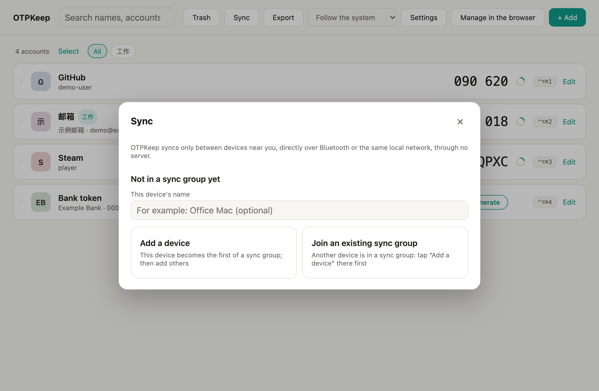
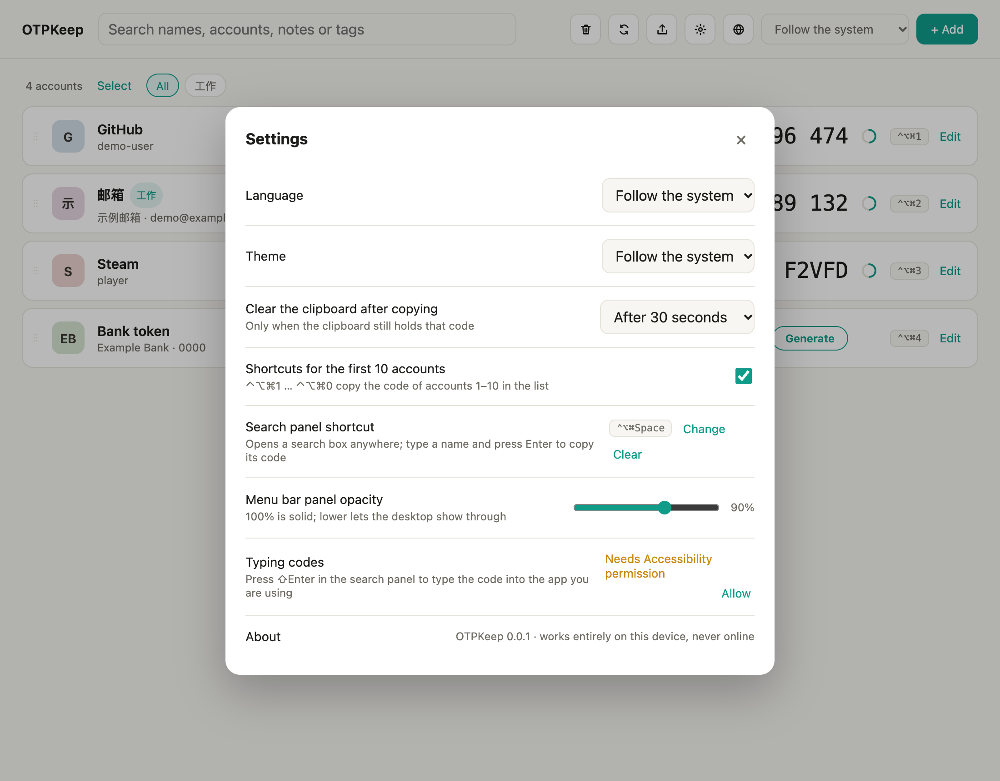

<div align="center">



# OTPKeep

**A free, private two-factor authenticator (TOTP / HOTP / Steam) that lives in your menu bar.**

Codes at hand with one click or one shortcut. Your accounts stay on your devices: no account, no cloud, no telemetry.

[简体中文](README.zh-CN.md) · [Features](#features) · [Screenshots](#screenshots) · [Install](#install) · [Usage](#usage) · [Security](#data-security-and-privacy)

[](https://github.com/weikxs/otpkeep/releases/latest)


<picture>
  <source media="(prefers-color-scheme: dark)" srcset="docs/images/en/main-dark.png">
  
</picture>

</div>

> [!IMPORTANT]
> OTPKeep 0.1.0 is the first release. Until you trust it, keep another copy of your two-factor accounts — an
> encrypted backup is one click away (**Export → Encrypted backup**).

## Contents

- [Status](#status)
- [Features](#features)
- [Screenshots](#screenshots)
- [Install](#install)
- [Building from source](#building-from-source)
- [Usage](#usage)
- [Keyboard shortcuts](#keyboard-shortcuts)
- [Command line](#command-line)
- [Data, security and privacy](#data-security-and-privacy)
- [Development](#development)
- [Project structure](#project-structure)
- [FAQ](#faq)
- [Contributing](#contributing) · [Security policy](#security-policy) · [License](#license)

## Status

| Platform | State |
|---|---|
| macOS 11+ | Released: one universal app for Apple silicon and Intel — menu bar panel, main window, search panel, typing codes, browser management page, import / export, local-network sync |
| Linux (x86_64, arm64) | Released: `.deb`, `.rpm` and AppImage; typing codes works on X11, not on Wayland |
| Windows | Planned |
| Android (APK) | Planned |
| iOS | Planned |
| Command line (`otpkeep`) | Working on all three desktop systems |

## Features

- **Codes at hand**
  - Menu bar / tray **quick panel**: click an account to copy its code; a countdown ring shows how long it lasts, and the next code appears in the last five seconds.
  - **Global shortcuts**: `⌃⌥⌘1` … `⌃⌥⌘0` copy the first ten accounts (macOS); any account can have its own shortcut.
  - **Search panel** (`⌃⌥⌘Space`): type a name, press Enter to copy, `⇧Enter` to **type the code** into the app you are using.
  - **Command line**: `otpkeep code github` prints a code.
- **Finds what you mean**: search names, services, accounts, tags and notes, including Chinese pinyin and initials (`yh` finds 银行).
- **Organised**: pin, drag to reorder, tags with filters, notes, a 30-day trash and an edit history per account.
- **Adds anything common**: `otpauth://` links (one or many), QR code images (also pasted from the clipboard), Google Authenticator transfer codes, Steam Guard, OTPKeep backups and GoldenPassport exports. Links with small mistakes (spaces, lower case, a missing issuer) are repaired; Microsoft and Oracle proprietary codes are recognised and explained instead of failing silently.
- **Exports anywhere**: an encrypted OTPKeep backup, `otpauth://` links, Google Authenticator transfer QR codes or a GoldenPassport file.
- **Browser management page**: rename accounts, write notes, set shortcuts and copy codes from a page OTPKeep serves on `127.0.0.1` only, opened with a one-time link.
- **Local-network sync, no servers**: pair your devices once, then sync them end to end encrypted over the same local network or Bluetooth, inside a short window you open, with a one-time code and your approval on the other device.
- **Private by design**: the data is encrypted on disk with a key kept in the system keychain, or derived from an optional master password. No telemetry, no accounts, no cloud.
- **Looks at home**: light and dark themes, English and Simplified Chinese, a translucent menu bar panel with adjustable opacity.

## Screenshots

<table>
  <tr>
    <td align="center" width="50%"><br><sub>Menu bar quick panel</sub></td>
    <td align="center" width="50%"><br><sub>…in dark mode</sub></td>
  </tr>
  <tr>
    <td align="center" colspan="2"><br><sub>Search panel: Enter copies, ⇧Enter types the code, ⌘E edits</sub></td>
  </tr>
  <tr>
    <td align="center" colspan="2"><br><sub>Browser management page: names, notes, shortcuts and codes</sub></td>
  </tr>
  <tr>
    <td align="center"><br><sub>Adding accounts: check the codes before saving</sub></td>
    <td align="center"><br><sub>Sync between your own devices</sub></td>
  </tr>
  <tr>
    <td align="center" colspan="2"><br><sub>Settings</sub></td>
  </tr>
</table>

Screenshots show made-up demo accounts. They are generated from `apps/desktop-mobile` with `README_SHOTS=../../docs/images pnpm e2e readme-shots`.

## Install

### macOS and Linux, fully automatic

```sh
curl -fsSL https://raw.githubusercontent.com/weikxs/otpkeep/main/install.sh | sh
```

The script picks the package for your system and CPU, checks it against the release's `checksums.txt` and
installs it — nothing else is changed:

| System | What it installs |
|---|---|
| macOS | `OTPKeep.app` into `/Applications` (or `~/Applications`), without the "downloaded from the internet" prompt |
| Debian, Ubuntu, Raspberry Pi OS | the `.deb`, with `apt` (asks for `sudo`) |
| Fedora, RHEL, openSUSE (x86_64) | the `.rpm`, with `dnf`, `zypper` or `yum` (asks for `sudo`) |
| Any other Linux | the AppImage, as `otpkeep-app` in `~/.local/bin`, with an applications-menu entry |

Run it again to upgrade. Options go after `sh -s --`, for example
`curl -fsSL https://raw.githubusercontent.com/weikxs/otpkeep/main/install.sh | sh -s -- --version v0.1.0`:

| Option | Meaning |
|---|---|
| `--version <tag>` | install this release instead of the latest |
| `--format deb\|rpm\|appimage` | Linux: choose the package format |
| `--dir <folder>` | macOS: where `OTPKeep.app` goes; AppImage: where `otpkeep-app` goes |
| `--no-modify-path` | AppImage: do not add the folder to your shell's `PATH` |

### Homebrew (macOS)

```sh
brew install --cask weikxs/tap/otpkeep
brew upgrade --cask otpkeep          # later, to upgrade
```

### Packages

Download from the [latest release](https://github.com/weikxs/otpkeep/releases/latest) and check the file against
`checksums.txt` (`shasum -a 256 -c checksums.txt --ignore-missing`):

| File | Platform |
|---|---|
| `otpkeep_<version>_darwin_universal.dmg` | macOS 11+, Apple silicon and Intel |
| `otpkeep_<version>_linux_amd64.deb` / `_arm64.deb` | Debian, Ubuntu, Raspberry Pi OS (x86_64 / arm64) |
| `otpkeep_<version>_linux_amd64.rpm` | Fedora, RHEL, openSUSE (x86_64) |
| `otpkeep_<version>_linux_amd64.AppImage` / `_arm64.AppImage` | Any Linux with glibc (x86_64 / arm64) |

The macOS app is not signed or notarized by Apple, and we do not plan to sign it. The script and Homebrew handle
that for you. If you install the disk image yourself, check it against `checksums.txt`, open OTPKeep once, then
choose **Open Anyway** in System Settings → Privacy & Security and open it again — or run
`xattr -dr com.apple.quarantine /Applications/OTPKeep.app`. Details in [SECURITY.md](SECURITY.md#release-packages-and-macos).

### Uninstall

| Installed with | Remove with |
|---|---|
| The script or the disk image (macOS) | Quit OTPKeep (menu bar icon → Quit), then move `OTPKeep.app` to the Trash |
| Homebrew | `brew uninstall --cask otpkeep` |
| `.deb` | `sudo apt remove otp-keep` |
| `.rpm` | `sudo dnf remove otp-keep` (or `sudo zypper remove otp-keep`) |
| AppImage | `rm ~/.local/bin/otpkeep-app ~/.local/share/applications/otpkeep.desktop ~/.local/share/icons/hicolor/256x256/apps/otpkeep.png` |

Uninstalling never touches your accounts: they stay in OTPKeep's [data folder](#data-security-and-privacy). To
remove them too, export a backup first if you may need them, then delete that folder.

## Building from source

### Prerequisites

| Tool | Version |
|---|---|
| Rust | 1.95 (installed automatically from `rust-toolchain.toml` by `rustup`) |
| Node.js | a current LTS release |
| pnpm | 11 (`corepack enable`) |
| Tauri system dependencies | see [Tauri prerequisites](https://v2.tauri.app/start/prerequisites/) (Xcode Command Line Tools on macOS, WebView2 on Windows, WebKitGTK on Linux) |

### Build and run

```sh
git clone https://github.com/weikxs/otpkeep.git
cd otpkeep

make app                      # the desktop app (debug build)
cargo build -p otpkeep-cli    # the otpkeep command → target/debug/otpkeep
```

`make app` leaves the app bundle under `target/debug/bundle/` (on macOS `OTPKeep.app`).

To try the app without touching your real data or keychain, start it in development mode with a throwaway
data folder and an in-memory keystore:

```sh
cd apps/desktop-mobile
OTPKEEP_DATA_DIR=/tmp/otpkeep-demo OTPKEEP_KEYSTORE=memory pnpm tauri dev
```

## Usage

### First start

OTPKeep starts in the **menu bar** (macOS) or the **system tray** (Windows, Linux); it has no Dock icon. Click the icon to open the
quick panel and add your first account: paste a link, drop or paste a QR code image, or import a file.

- **Left click** the icon: the quick panel.
- **Right click** the icon: open the main window, manage in the browser, sync, settings, quit.

### Main window

Lists every account with its code. Click a row to copy. **Edit** opens the account's names, note, tags, pin, place in the list,
code settings, own shortcut, QR code and history. **Select** chooses several accounts to tag, export or move to the trash at once.

### Search panel and typing codes

Press `⌃⌥⌘Space` anywhere (macOS default; set or turn it off in Settings). Type part of a name, account, note or tag:

- `Enter` copies the code and closes.
- `⇧Enter` types the code into the field you were in. On macOS this needs **Accessibility** permission
  (System Settings → Privacy & Security → Accessibility); without it, on Wayland, while the main window is open (macOS), or
  when no key could be sent, the code is copied instead and the panel says so.
- `⌘E` (`Ctrl+E`) opens the account in the main window; `Esc` clears the search, then closes.

### Counter-based (HOTP) accounts

Time-based codes change every 30 seconds by themselves. Counter-based (HOTP) codes, used by some bank tokens, move a counter forward each
time one is made, so OTPKeep does not show one until you press **Generate**; otherwise every glance would use up a code.

### Browser management page

Choose **Manage in the browser** from the menu. OTPKeep serves the page on `127.0.0.1` with a one-time link; the session ends when the tab closes or after 45 seconds without it.
You can rename accounts, write notes, set or clear each account's shortcut, and copy codes (OTPKeep writes the clipboard itself).

### Importing and exporting

| Import | Notes |
|---|---|
| `otpauth://totp/…`, `otpauth://hotp/…`, `otpauth://steam/…` | one or many, also inside other text |
| QR code images | files, drag and drop, or a pasted screenshot; several codes in one image |
| Google Authenticator transfer codes | `otpauth-migration://` links or their QR codes |
| OTPKeep backup | encrypted with a backup password |
| GoldenPassport export | `.secrets` or `accounts.json` |

Every import shows a preview with the current codes, so you can compare them with the website before anything is saved; accounts you already have are recognised.

Export from the main window (all accounts or the selected ones) as an **encrypted backup** (recommended), `otpauth://` links,
Google Authenticator transfer QR codes, or a GoldenPassport file. Every format except the backup is unencrypted, and OTPKeep asks before writing one.

### Sync between your devices

1. On the first device: **Sync → Add a device**. It shows an eight-digit pairing code (and a QR invite).
2. On the new device: **Sync → Join an existing sync group**, pick the waiting device and enter the code.
3. Compare the six-digit check code on both screens and confirm.

Later syncs: open a **sync window** on one device and enter its code on the other; the first device asks you to allow it.
Sync works only between devices near each other, over the same local network or Bluetooth, while a window is open (1–5 minutes). There is no server.

### Settings

Language (system, English, 中文), theme, clearing the clipboard after copying (default 30 seconds), shortcuts for the first ten accounts,
the search panel shortcut, the menu bar panel's opacity, and typing permission.

## Keyboard shortcuts

| Where | Keys | Action |
|---|---|---|
| Anywhere (macOS default) | `⌃⌥⌘1` … `⌃⌥⌘0` | Copy the code of account 1–10 in the list |
| Anywhere (macOS default) | `⌃⌥⌘Space` | Open the search panel |
| Anywhere | your choice | Copy one account's code (set per account) |
| Quick panel | `↑` `↓` `Enter` | Choose and copy |
| Quick panel | `⌘1` … `⌘9`, `⌘0` | Copy row 1–10 |
| Search panel | `Enter` / `⇧Enter` | Copy / type the code |
| Search panel | `⌘E`, `Esc` | Edit in the main window, clear then close |

On Windows and Linux the global shortcuts start turned off; choose them in Settings. Combinations with only `Shift` are refused, so typing is never captured.

## Command line

```console
$ otpkeep code github          # the code of the one account matching "github"
$ otpkeep list --tag work      # names only, never codes
$ otpkeep import accounts.txt  # links, QR images, backups, GoldenPassport exports
$ otpkeep export --format backup --out otpkeep.backup
$ otpkeep sync join            # sync with a device that opened a sync window
```

Run `otpkeep help` for every command (`init`, `import`, `export`, `sync wait|join`, `pair open|join`, `devices`, `group leave`, `rename`, …).
Every vault command accepts `--json` for machine-readable output and `--password-stdin` for a master password from standard input.

## Data, security and privacy

| | |
|---|---|
| **Where** | macOS `~/Library/Application Support/OTPKeep` · Windows `%LOCALAPPDATA%\OTPKeep` · Linux `$XDG_DATA_HOME/otpkeep` (default `~/.local/share/otpkeep`); `OTPKEEP_DATA_DIR` overrides it |
| **Encryption at rest** | XChaCha20-Poly1305; the key is kept in the system keychain (Keychain, Credential Manager, Secret Service), or derived from an optional master password with Argon2id |
| **Backups** | encrypted with a separate backup password |
| **Sync** | Noise XX (X25519, ChaCha20-Poly1305, BLAKE2s) between Ed25519 device identities; the one-time code is checked with SPAKE2, so a recorded session cannot be brute-forced offline |
| **Clipboard** | copied codes are kept out of clipboard history apps and cleared 30 seconds (adjustable) after the last copy, or when OTPKeep quits, only if the clipboard still holds that code |
| **Network** | none, except local-network / Bluetooth sync while you have a window open, and the management page on `127.0.0.1` |
| **Telemetry** | none |

There is deliberately **no app lock**: the master password (optional) is asked once per start, and the system's own screen lock protects an unattended computer.
The app never reads keys, passwords or keychain items other than its own.

The menu bar panel uses a transparent window, which needs macOS private API; for that reason OTPKeep is distributed directly rather than through the Mac App Store.

## Development

```sh
make check      # all checks: privacy, format, clippy, tests, coverage, cargo-deny, audit, performance, simulation
make test       # Rust and UI tests
make fmt        # format the Rust code
make hooks      # use the repository's git hooks
cd apps/desktop-mobile && pnpm test     # UI unit tests (Vitest)
cd apps/desktop-mobile && pnpm e2e      # browser tests (Playwright)
```

Tests write only under `/tmp/otpkeep-test` and use demo data. See [CONTRIBUTING.md](CONTRIBUTING.md) and the [development standards](docs/development/standards.md).

## Project structure

```
apps/
  cli/              the otpkeep command
  desktop-mobile/   the Tauri app: Rust shell (src-tauri) and Preact interface (src)
crates/
  keep-passcode     HOTP, TOTP and Steam codes, Base32
  keep-keyuri       otpauth:// links: parsing, repairing, writing
  keep-vault        the encrypted vault: entries, keys, storage, locking, migration
  keep-find         search with pinyin and initials
  keep-transfer     backups, Google Authenticator transfer codes, QR codes, GoldenPassport files
  keep-platform     keychain, data folders and other platform services
  keep-sync         pairing and sync: windows, handshakes, membership, merging
  keep-link         reaching another device over the local network or Bluetooth
  keep-ble          Bluetooth Low Energy transport
  keep-gate         the browser management page server
  keep-ffi          reserved for Swift and Kotlin bindings
docs/               development standards and images
fuzz/               fuzz targets for the parsers
```

## FAQ

**Why does an account show "Generate" instead of a code?** It is a counter-based (HOTP) account; see [above](#counter-based-hotp-accounts).

**Can I sync through iCloud, Dropbox or a server?** No. Sync happens only directly between your devices, near each other, when you open a window. Use encrypted backups to keep a copy elsewhere.

**Is there a Mac App Store version?** No; see [Data, security and privacy](#data-security-and-privacy).

**Why is the Linux package called `otp-keep`?** The package tools derive it from the app's name; the program itself
is `otpkeep-app`, and the command line is `otpkeep`.

**Typing codes does nothing.** Grant Accessibility permission (macOS). On Wayland, typing is not possible and the code is copied instead.

## Contributing

Issues and pull requests are welcome. Please read [CONTRIBUTING.md](CONTRIBUTING.md) and the [code of conduct](CODE_OF_CONDUCT.md) first.
Notable changes are recorded in the [changelog](CHANGELOG.md).

## Security policy

Please report vulnerabilities privately as described in [SECURITY.md](SECURITY.md), not in public issues.

## License

Not chosen yet. Until a license file is added, all rights are reserved.
