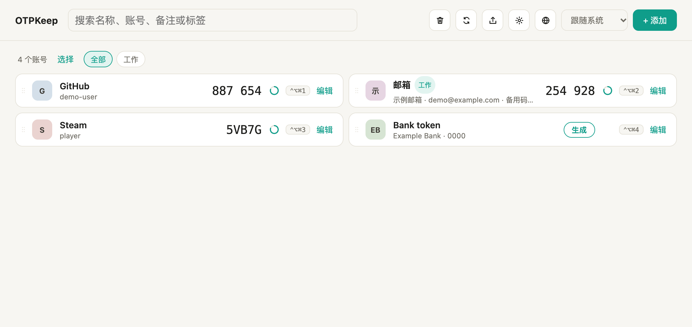
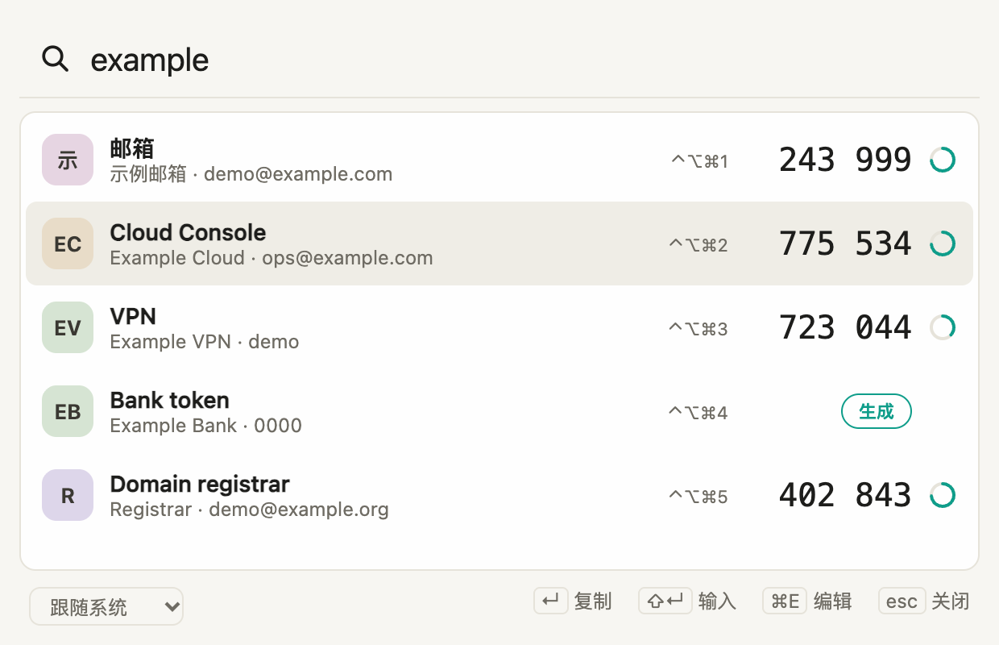
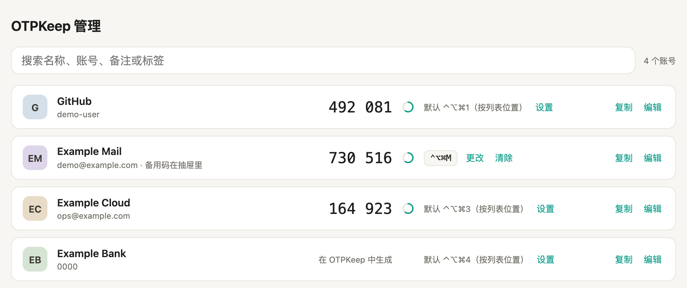
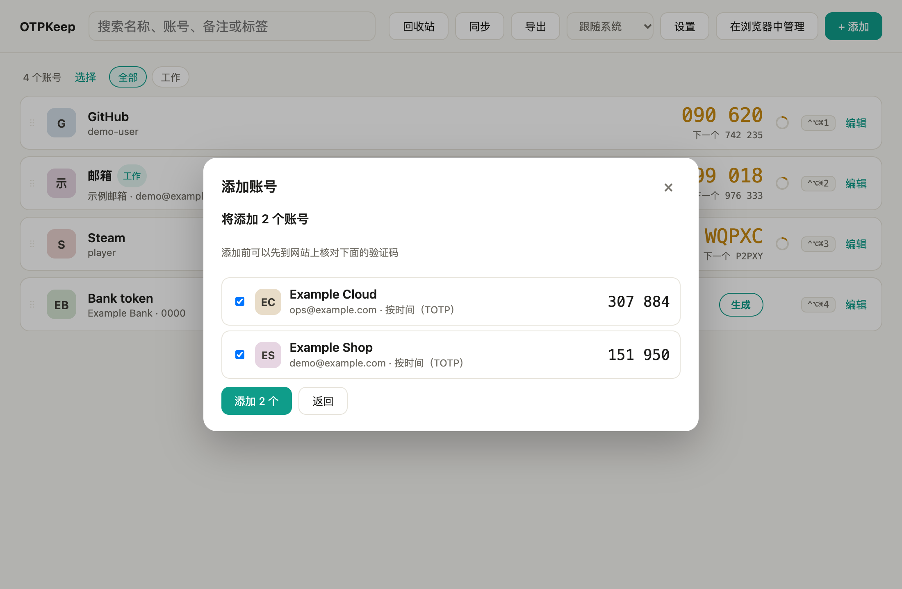
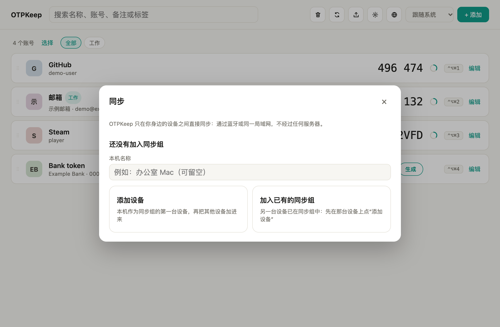
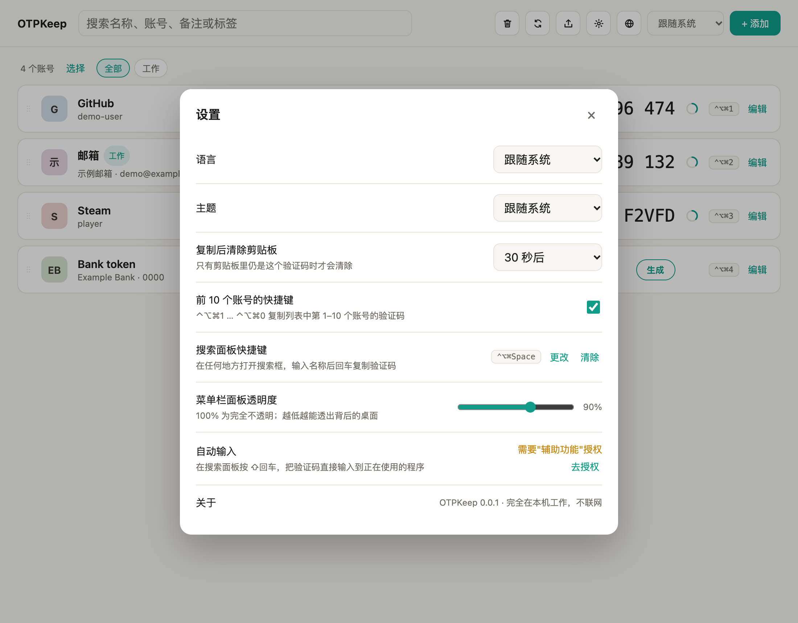

<div align="center">


# OTPKeep

**免费、注重隐私的两步验证器（TOTP / HOTP / Steam），常驻菜单栏。**

点一下或按一个快捷键就能拿到验证码。账号只留在你自己的设备上：不用注册，不上云，没有遥测。

[English](README.md) · [功能](#功能) · [截图](#截图) · [安装](#安装) · [使用](#使用) · [安全](#数据安全与隐私)

[](https://github.com/weikxs/otpkeep/releases/latest)


<picture>
  <source media="(prefers-color-scheme: dark)" srcset="docs/images/zh/main-dark.png">
  
</picture>

</div>

> [!IMPORTANT]
> OTPKeep 0.1.0 是第一个正式版本。在你完全信任它之前，请另外保留一份两步验证账号：加密备份一键即可导出
> （**导出 → 加密备份**）。

## 目录

- [当前状态](#当前状态)
- [功能](#功能)
- [截图](#截图)
- [安装](#安装)
- [从源码构建](#从源码构建)
- [使用](#使用)
- [快捷键](#快捷键)
- [命令行](#命令行)
- [数据安全与隐私](#数据安全与隐私)
- [开发](#开发)
- [项目结构](#项目结构)
- [常见问题](#常见问题)
- [参与贡献](#参与贡献) · [安全问题报告](#安全问题报告) · [许可证](#许可证)

## 当前状态

| 平台 | 状态 |
|---|---|
| macOS 11+ | 已发布：同一个 App 同时支持 Apple 芯片和 Intel——菜单栏菜单、主窗口、搜索面板、自动输入、浏览器管理页、导入导出、局域网同步 |
| Linux（x86_64、arm64） | 已发布：`.deb`、`.rpm` 和 AppImage；自动输入支持 X11，不支持 Wayland |
| Windows | 后续支持 |
| Android（APK） | 后续支持 |
| iOS | 后续支持 |
| 命令行（`otpkeep`） | 三个桌面系统均可用 |

## 功能

- **随手取码**
  - 菜单栏 / 托盘**菜单**：列出置顶和最近用过的账号及其当前验证码，点一下即复制。这是系统自带的菜单，OTPKeep 在菜单栏待命时不运行任何网页。
  - **全局快捷键**：`⌃⌥⌘1` … `⌃⌥⌘0` 复制列表前 10 个账号（macOS）；任何账号都可以单独设快捷键。
  - **搜索面板**（`⌃⌥⌘Space`）：输入名称，回车复制，`⇧回车` **把验证码直接输入**到正在用的程序。
  - **命令行**：`otpkeep code github` 直接输出验证码。
- **搜得到**：按名称、服务商、账号、标签、备注搜索，支持中文拼音和首字母（输入 `yh` 能找到"银行"）。
- **好整理**：置顶、拖动排序、标签与筛选、备注、30 天回收站、每个账号的修改历史。
- **常见格式都能加**：`otpauth://` 链接（单个或多个）、二维码图片（也可以直接粘贴截图）、Google Authenticator 转移码、Steam 令牌、OTPKeep 备份、GoldenPassport 导出文件。链接里的小错误（多余空格、小写、缺服务商）会自动修正；微软、Oracle 的私有格式会识别并说明原因，不会无声失败。
- **导出到哪都行**：加密的 OTPKeep 备份、`otpauth://` 链接、Google Authenticator 转移二维码、GoldenPassport 文件。
- **浏览器管理页**：改名称、写备注、设快捷键、复制验证码。页面只在 `127.0.0.1` 上提供，用一次性链接打开。
- **局域网同步，没有服务器**：设备配对一次后，在同一局域网或蓝牙范围内、在你打开的限时窗口里端到端加密同步；每次都要输入一次性码，并在另一台设备上确认。
- **隐私优先**：数据加密保存，密钥放在系统钥匙串里，或由可选的主口令派生。没有遥测、不用注册、不上云。
- **原生观感**：浅色 / 深色主题，English / 简体中文，菜单栏使用系统自带的菜单。

## 截图

<table>
  <tr>
    <td align="center" colspan="2"><br><sub>搜索面板：回车复制，⇧回车输入验证码，⌘E 编辑</sub></td>
  </tr>
  <tr>
    <td align="center" colspan="2"><br><sub>浏览器管理页：名称、备注、快捷键与验证码</sub></td>
  </tr>
  <tr>
    <td align="center"><br><sub>添加账号：保存前先核对验证码</sub></td>
    <td align="center"><br><sub>在自己的设备之间同步</sub></td>
  </tr>
  <tr>
    <td align="center" colspan="2"><br><sub>设置</sub></td>
  </tr>
</table>

截图中均为虚构的演示账号，在 `apps/desktop-mobile` 下运行 `README_SHOTS=../../docs/images pnpm e2e readme-shots` 生成。

## 安装

### macOS 和 Linux，全自动

```sh
curl -fsSL https://raw.githubusercontent.com/weikxs/otpkeep/main/install.sh | sh
```

脚本会按你的系统和芯片选对安装包，先用发布页的 `checksums.txt` 核对，再安装，不改动其他任何东西：

| 系统 | 安装什么 |
|---|---|
| macOS | 把 `OTPKeep.app` 放进 `/Applications`（没有权限时放进 `~/Applications`），打开时不会再弹"来自互联网"的拦截 |
| Debian、Ubuntu、树莓派系统 | `.deb`，用 `apt` 安装（会要求 `sudo`） |
| Fedora、RHEL、openSUSE（x86_64） | `.rpm`，用 `dnf`、`zypper` 或 `yum` 安装（会要求 `sudo`） |
| 其他 Linux | AppImage，装成 `~/.local/bin/otpkeep-app`，并加入应用菜单 |

再运行一次就是升级。选项写在 `sh -s --` 后面，例如
`curl -fsSL https://raw.githubusercontent.com/weikxs/otpkeep/main/install.sh | sh -s -- --version v0.1.0`：

| 选项 | 作用 |
|---|---|
| `--version <标签>` | 安装指定版本，而不是最新版 |
| `--format deb\|rpm\|appimage` | Linux：指定安装包格式 |
| `--dir <目录>` | macOS：`OTPKeep.app` 放在哪里；AppImage：`otpkeep-app` 放在哪里 |
| `--no-modify-path` | AppImage：不把目录加入 shell 的 `PATH` |

### Homebrew（macOS）

```sh
brew install --cask weikxs/tap/otpkeep
brew upgrade --cask otpkeep          # 以后升级
```

### 安装包

从[最新发布页](https://github.com/weikxs/otpkeep/releases/latest)下载，并用 `checksums.txt` 核对
（`shasum -a 256 -c checksums.txt --ignore-missing`）：

| 文件 | 平台 |
|---|---|
| `otpkeep_<版本>_darwin_universal.dmg` | macOS 11+，Apple 芯片和 Intel |
| `otpkeep_<版本>_linux_amd64.deb` / `_arm64.deb` | Debian、Ubuntu、树莓派系统（x86_64 / arm64） |
| `otpkeep_<版本>_linux_amd64.rpm` | Fedora、RHEL、openSUSE（x86_64） |
| `otpkeep_<版本>_linux_amd64.AppImage` / `_arm64.AppImage` | 任何使用 glibc 的 Linux（x86_64 / arm64） |

macOS 版没有 Apple 签名，也没有经过 Apple 公证，今后也不打算签名。安装脚本和 Homebrew 会替你处理；如果你自己从磁盘镜像安装，
请先用 `checksums.txt` 核对，打开一次 OTPKeep，再到"系统设置 → 隐私与安全性"里点"仍要打开"，然后再打开一次——或者运行
`xattr -dr com.apple.quarantine /Applications/OTPKeep.app`。详见 [SECURITY.md](SECURITY.md#release-packages-and-macos)。

### 卸载

| 安装方式 | 卸载方法 |
|---|---|
| 安装脚本或磁盘镜像（macOS） | 先退出 OTPKeep（菜单栏图标 → 退出），再把 `OTPKeep.app` 移到废纸篓 |
| Homebrew | `brew uninstall --cask otpkeep` |
| `.deb` | `sudo apt remove otp-keep` |
| `.rpm` | `sudo dnf remove otp-keep`（或 `sudo zypper remove otp-keep`） |
| AppImage | `rm ~/.local/bin/otpkeep-app ~/.local/share/applications/otpkeep.desktop ~/.local/share/icons/hicolor/256x256/apps/otpkeep.png` |

卸载不会碰你的账号：它们留在 OTPKeep 的[数据目录](#数据安全与隐私)里。如果也要删除，请先导出备份以防万一，再删除那个目录。

## 从源码构建

### 准备

| 工具 | 版本 |
|---|---|
| Rust | 1.95（`rustup` 会按 `rust-toolchain.toml` 自动安装） |
| Node.js | 当前的 LTS 版本 |
| pnpm | 11（`corepack enable`） |
| Tauri 系统依赖 | 见 [Tauri 环境准备](https://v2.tauri.app/start/prerequisites/)（macOS 需要 Xcode Command Line Tools，Windows 需要 WebView2，Linux 需要 WebKitGTK） |

### 构建与运行

```sh
git clone https://github.com/weikxs/otpkeep.git
cd otpkeep

make app                      # 桌面应用（调试版）
cargo build -p otpkeep-cli    # otpkeep 命令 → target/debug/otpkeep
```

`make app` 生成的应用在 `target/debug/bundle/` 下（macOS 上是 `OTPKeep.app`）。

想先试用、又不想碰真实数据和系统钥匙串，可以用临时数据目录和内存钥匙串以开发模式启动：

```sh
cd apps/desktop-mobile
OTPKEEP_DATA_DIR=/tmp/otpkeep-demo OTPKEEP_KEYSTORE=memory pnpm tauri dev
```

## 使用

### 第一次启动

OTPKeep 启动后常驻在**菜单栏**（macOS）或**系统托盘**（Windows、Linux），程序坞里没有图标。点图标打开菜单，选**打开 OTPKeep**，添加第一个账号：粘贴链接、拖入或粘贴二维码图片，或者导入文件。

### 菜单栏菜单

点图标会打开一个由系统绘制的菜单（不为它运行网页）：

- 最多 15 个账号：先是置顶的，再是最近用过的，每个都带当前验证码（`Example Cloud   123 456`），有自己的快捷键时也会显示。
  最近复制过验证码的 10 个账号（无论从菜单、快捷键、搜索面板、主窗口还是管理页复制）只以 id 记在本机的设置文件里，从不同步。
  点账号即复制验证码，剪贴板照常按时清除。计数器型（HOTP）账号显示**（点击获取验证码）**，点它时生成新的验证码。
- **搜索全部账号…** 打开搜索面板（`⌃⌥⌘Space`），然后是**打开 OTPKeep**（主窗口）、**在浏览器中管理…**、**同步…**、**设置…**和**退出 OTPKeep**。

验证码到期、账号变化以及鼠标移到图标上时，菜单里的验证码都会更新。设置了主口令时，输入口令之前菜单只提供**解锁…**：
它打开一个小窗口输入主口令，数据打开后窗口自动关闭；在此之前按下快捷键也会打开这个窗口。数据无法打开时，菜单会说明原因，并提供**重试**或打开主窗口。

主窗口和搜索面板关闭 30 秒后会被彻底关掉，所以 OTPKeep 在菜单栏待命时不运行任何网页。

### 主窗口

列出所有账号和验证码，点一行即复制。**编辑**可以修改名称、备注、标签、置顶、排序位置、验证码参数、本条快捷键，也能查看二维码和修改历史。**选择**可以一次给多个账号加标签、导出或移入回收站。

### 搜索面板与自动输入

在任何地方按 `⌃⌥⌘Space`（macOS 默认，可在设置中更改或关闭），输入名称、账号、备注或标签的一部分：

- `回车`：复制验证码并关闭。
- `⇧回车`：把验证码输入到刚才所在的输入框。macOS 上需要**辅助功能**授权（系统设置 → 隐私与安全性 → 辅助功能）；没有授权、在 Wayland 下、主窗口开着时（macOS）或按键没能发出时，会改为复制，并给出提示。
- `⌘E`（`Ctrl+E`）：在主窗口中打开这个账号；`Esc`：先清空搜索词，再按一次关闭。

### 计数器型（HOTP）账号

时间型验证码每 30 秒自动更换。计数器型（HOTP，一些银行令牌在用）每生成一次，计数器就前进一格，所以要点**生成**才会出现验证码；否则每看一眼都会消耗一个码。

### 浏览器管理页

在菜单中选**在浏览器中管理**。OTPKeep 只在 `127.0.0.1` 上提供这个页面，用一次性链接打开；关闭标签页或 45 秒没有响应后会话结束。
可以改名称、写备注、设置或清除每个账号的快捷键、复制验证码（由 OTPKeep 自己写剪贴板）。

### 导入与导出

| 导入 | 说明 |
|---|---|
| `otpauth://totp/…`、`otpauth://hotp/…`、`otpauth://steam/…` | 单个或多个，夹在其他文字里也能识别 |
| 二维码图片 | 文件、拖放或粘贴截图；一张图里可以有多个码 |
| Google Authenticator 转移码 | `otpauth-migration://` 链接或其二维码 |
| OTPKeep 备份 | 用备份口令加密 |
| GoldenPassport 导出 | `.secrets` 或 `accounts.json` |

每次导入都会先显示预览和当前验证码，可以先到网站上核对再保存；已有的账号会被识别出来。

在主窗口导出（全部或所选账号），格式可选：**加密备份**（推荐）、`otpauth://` 链接、Google Authenticator 转移二维码、GoldenPassport 文件。除备份外的格式都不加密，写出前会先确认。

### 在自己的设备之间同步

1. 第一台设备：**同步 → 添加设备**，屏幕上会显示 8 位配对码（以及二维码邀请）。
2. 新设备：**同步 → 加入已有的同步组**，选择正在等待的设备，输入配对码。
3. 核对两边屏幕上的 6 位校验码，确认。

之后再同步：在一台设备上打开**同步窗口**，在另一台上输入它显示的码，第一台设备会请你确认允许。
只在彼此靠近的设备之间、通过同一局域网或蓝牙、在窗口打开期间（1–5 分钟）同步，没有服务器。

### 设置

语言（跟随系统 / English / 中文）、主题、复制后清除剪贴板（默认 30 秒）、前 10 个账号的快捷键、搜索面板快捷键、自动输入授权。

## 快捷键

| 位置 | 按键 | 作用 |
|---|---|---|
| 任何地方（macOS 默认） | `⌃⌥⌘1` … `⌃⌥⌘0` | 复制列表第 1–10 个账号的验证码 |
| 任何地方（macOS 默认） | `⌃⌥⌘Space` | 打开搜索面板 |
| 任何地方 | 自定 | 复制某个账号的验证码（逐个设置） |
| 搜索面板 | `回车` / `⇧回车` | 复制 / 输入验证码 |
| 搜索面板 | `⌘E`、`Esc` | 在主窗口编辑；先清空再关闭 |

Windows 和 Linux 上全局快捷键默认关闭，可在设置中选择。只带 `Shift` 的组合会被拒绝，避免拦截正常打字。

## 命令行

```console
$ otpkeep code github          # 输出唯一匹配 "github" 的账号的验证码
$ otpkeep list --tag work      # 只列名称，从不输出验证码
$ otpkeep import accounts.txt  # 链接、二维码图片、备份、GoldenPassport 导出
$ otpkeep export --format backup --out otpkeep.backup
$ otpkeep sync join            # 与打开了同步窗口的设备同步
```

运行 `otpkeep help` 查看全部命令（`init`、`import`、`export`、`sync wait|join`、`pair open|join`、`devices`、`group leave`、`rename` 等）。
所有读写数据的命令都支持 `--json`（机器可读输出）和 `--password-stdin`（从标准输入读主口令）。

## 数据安全与隐私

| | |
|---|---|
| **存放位置** | macOS `~/Library/Application Support/OTPKeep` · Windows `%LOCALAPPDATA%\OTPKeep` · Linux `$XDG_DATA_HOME/otpkeep`（默认 `~/.local/share/otpkeep`）；可用 `OTPKEEP_DATA_DIR` 指定 |
| **本地加密** | XChaCha20-Poly1305；密钥存放在系统钥匙串（macOS 钥匙串、Windows 凭据管理器、Linux Secret Service），或用 Argon2id 从可选的主口令派生 |
| **备份** | 用单独的备份口令加密 |
| **同步** | 设备身份为 Ed25519，通道为 Noise XX（X25519、ChaCha20-Poly1305、BLAKE2s）；一次性码用 SPAKE2 校验，录下的会话无法离线暴力破解 |
| **剪贴板** | 复制的验证码不进入剪贴板历史类应用，最后一次复制 30 秒（可调）后或退出 OTPKeep 时清除，且只在剪贴板里仍是这个码时才清除 |
| **网络** | 除了你打开窗口期间的局域网 / 蓝牙同步，以及 `127.0.0.1` 上的管理页，不联网 |
| **遥测** | 没有 |
| **日志** | 只记警告和错误，从不记密钥、验证码或账号名称，写在 `otpkeep.log`（最多 1 MB，另留一个旧文件）：macOS 在 `~/Library/Logs/io.github.weikxs.otpkeep`，其他系统在本地应用数据目录下 `io.github.weikxs.otpkeep` 的 `logs` 文件夹 |

OTPKeep 有意**不提供应用锁**：主口令（可选）每次启动输入一次，离开电脑时由系统锁屏保护。
程序不会读取自己之外的任何密钥、口令或钥匙串条目。

## 开发

```sh
make check      # 全部检查：隐私、格式、clippy、测试、覆盖率、cargo-deny、audit、性能、同步模拟
make test       # Rust 与界面测试
make fmt        # 格式化 Rust 代码
make hooks      # 使用仓库自带的 git 钩子
cd apps/desktop-mobile && pnpm test     # 界面单元测试（Vitest）
cd apps/desktop-mobile && pnpm e2e      # 浏览器测试（Playwright）
```

测试只写 `/tmp/otpkeep-test`，只用演示数据。详见 [CONTRIBUTING.md](CONTRIBUTING.md) 和[开发规范](docs/development/standards.md)。

## 项目结构

```
apps/
  cli/              otpkeep 命令
  desktop-mobile/   Tauri 应用：Rust 外壳（src-tauri）与 Preact 界面（src）
crates/
  keep-passcode     HOTP、TOTP、Steam 验证码与 Base32
  keep-keyuri       otpauth:// 链接的解析、修正与生成
  keep-vault        加密保管库：条目、密钥、存储、锁、版本迁移
  keep-find         支持拼音与首字母的搜索
  keep-transfer     备份、Google Authenticator 转移码、二维码、GoldenPassport 文件
  keep-platform     钥匙串、数据目录等平台服务
  keep-sync         配对与同步：窗口、握手、成员、合并
  keep-link         通过局域网或蓝牙连接另一台设备
  keep-ble          低功耗蓝牙传输
  keep-gate         浏览器管理页服务
  keep-ffi          预留给 Swift / Kotlin 绑定
docs/               开发规范与图片
fuzz/               解析器的模糊测试
```

## 常见问题

**为什么有的账号显示"生成"而不是验证码？** 它是计数器型（HOTP）账号，见[上文](#计数器型hotp账号)。

**能通过 iCloud、Dropbox 或服务器同步吗？** 不能。只在你打开窗口时、在彼此靠近的设备之间直接同步。想在别处留一份，请用加密备份。

**有 Mac App Store 版本吗？** 没有，原因见[数据安全与隐私](#数据安全与隐私)。

**为什么 Linux 安装包叫 `otp-keep`？** 打包工具是从 App 名称自动生成这个名字的；程序本身叫 `otpkeep-app`，命令行工具叫 `otpkeep`。

**自动输入没反应？** macOS 上请授予辅助功能权限；Wayland 下无法自动输入，会改为复制。

## 参与贡献

欢迎提 issue 和 pull request，请先阅读 [CONTRIBUTING.md](CONTRIBUTING.md) 和[行为准则](CODE_OF_CONDUCT.md)。重要变更记录在[更新日志](CHANGELOG.md)。

## 安全问题报告

请按 [SECURITY.md](SECURITY.md) 私下报告安全漏洞，不要发公开 issue。

## 许可证

待定。在添加许可证文件之前，保留所有权利。
